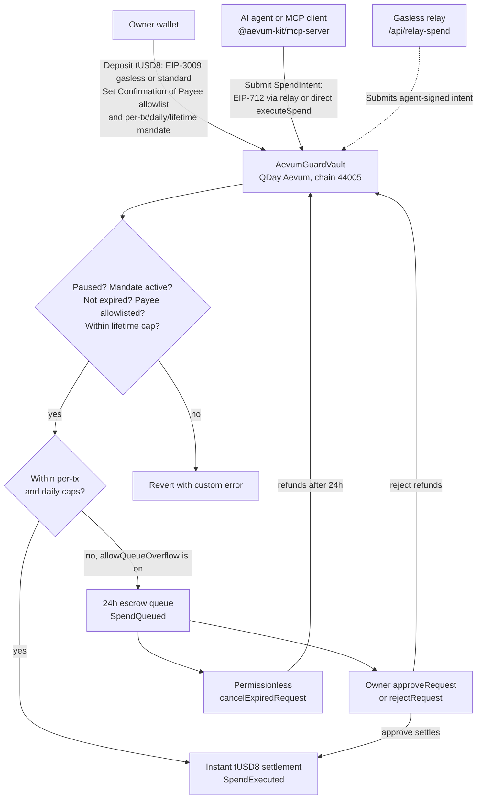

# AevumGuard

On-chain `tUSD8` spending guardrails and a non-custodial MCP server for autonomous AI agents on QDay Aevum Testnet (chain ID `44005`).

| Resource | Link |
|---|---|
| Live Control Center (no wallet required) | https://aevum-guard.vercel.app/ |
| Architecture & Docs | https://aevum-guard.vercel.app/docs |
| Demo Video (1:14) | https://www.youtube.com/watch?v=GYDz2hm_MUY |
| Vault contract (`AevumGuardVault`) | [`0x4E5Ed4Dc7E5e525f4D77c2cC2749870De9f6851e`](https://explorer-test.qday.info/address/0x4E5Ed4Dc7E5e525f4D77c2cC2749870De9f6851e), block `3685765` |
| Source (MIT) | https://github.com/muradcift/aevum-guard |

Built for Aevum Builder Challenge #1 (QDay): Native AI Assistants, Confirmation of Payee, Decentralized Payments.

## How It Works

A treasury owner deposits `tUSD8` into a vault and sets a spend mandate: per-transaction limit, rolling UTC-day limit, lifetime budget, expiry, and a payee allowlist. An AI agent can then spend on its own, but only inside those bounds. Anything larger moves to a 24-hour escrow queue for owner approval.

The contract enforces every limit. Relayers and the MCP server only move signatures and read state.



Gasless paths:

- Deposits: `tUSD8` EIP-3009 `receiveWithAuthorization` with a vault-bound nonce, so a signature cannot be replayed against another vault or contract.
- Agent spends: off-chain EIP-712 `SpendIntent` signed by the agent, submitted through `/api/relay-spend` or directly to `executeSpendWithSignature`. The agent needs no `tQDAY`.

## AI Agent MCP Server (`@aevum-kit/mcp-server`)

`packages/mcp-server` is a JSON-RPC 2.0 stdio MCP server. It reads live vault state and returns unsigned EIP-712 intent data only when policy allows. It holds zero private keys, never signs, and never submits transactions.

| Tool | Purpose |
|---|---|
| `get_vault_status` | Read vault balance, policy, and agent mandate |
| `check_payee_verified` | Check a recipient against the Confirmation of Payee allowlist |
| `simulate_agent_spend` | Simulate a spend against live limits and return the decision |
| `prepare_gasless_spend_intent` | Build an unsigned EIP-712 `SpendIntent` when the spend is allowed |

One command runs four live assertions against QDay Testnet:

```sh
pnpm mcp:demo
```

1. Reads live Vault #1 status.
2. Sends a prompt-injected rogue recipient `0x...dEaD` and gets `BLOCKED_REVERT / PayeeNotAllowlisted`, with no EIP-712 intent issued.
3. Sends `0.40 tUSD8` to the verified vendor and gets `PASS_INSTANT`.
4. Sends `0.85 tUSD8` and gets `ESCALATE_24H_ESCROW`.

The demo is read-only. It creates no signatures and no transactions.

Claude Desktop or Cursor config:

```json
{
  "mcpServers": {
    "aevumguard": {
      "command": "pnpm",
      "args": ["--filter", "@aevum-kit/mcp-server", "start"],
      "cwd": "D:/path/to/aevum-guard"
    }
  }
}
```

Optional server env vars: `AEVUM_RPC_URL`, `AEVUM_VAULT_ADDRESS`, `AEVUM_VAULT_ID`, `AEVUM_AGENT_ADDRESS`. Amounts use 6-decimal base units, so `0.40 tUSD8` is `400000`.

## Live QDay Aevum Testnet Deployment

| Item | Value |
|---|---|
| Network | QDay Aevum Testnet, chain ID `44005` |
| EVM | Shanghai (`solc 0.8.24`, `evm_version = "shanghai"`, verified by `pnpm check:shanghai`) |
| RPC | `https://rpc-test.qday.info` |
| `tUSD8` | [`0x456569838f1d43009A91ebA4263147Afd7233483`](https://explorer-test.qday.info/address/0x456569838f1d43009A91ebA4263147Afd7233483), 6 decimals, EIP-3009 v2 |
| `AevumGuardVault` | [`0x4E5Ed4Dc7E5e525f4D77c2cC2749870De9f6851e`](https://explorer-test.qday.info/address/0x4E5Ed4Dc7E5e525f4D77c2cC2749870De9f6851e), block `3685765` |
| Owner | [`0xa7E93BA94DB2F631A92aCa5186d43bC2A0E646A3`](https://explorer-test.qday.info/address/0xa7E93BA94DB2F631A92aCa5186d43bC2A0E646A3) |
| Demo Agent (0 tQDAY) | [`0xCE45f546D53746acabB6FB34c87AFE6433A83b3a`](https://explorer-test.qday.info/address/0xCE45f546D53746acabB6FB34c87AFE6433A83b3a) |
| Verified Payee | `Cloud Compute Vendor`, [`0x5b0C9bE853C8cafDC9CA914744eEC5e486aB1260`](https://explorer-test.qday.info/address/0x5b0C9bE853C8cafDC9CA914744eEC5e486aB1260) |

### Evidence: 10 Transactions

| Step | Action | Block | Transaction |
|---|---|---|---|
| 0 | Deploy `AevumGuardVault` | `3685765` | [`0x78b5...2ea8`](https://explorer-test.qday.info/tx/0x78b50784a62fa61ae9447c3618a6c7882787a1167548b95d9066f0b221a82ea8) |
| 1 | `createVault("AevumGuard Live AI Ops Vault", enforceAllowlist=true)` | `3685823` | [`0x8682...f34b`](https://explorer-test.qday.info/tx/0x86824f6093cd388ccb452bd128d1348ea3580b11f1644f7b1ec1b5d35141f34b) |
| 2 | `depositWithAuthorization`: gasless EIP-3009, `3.00 tUSD8` | `3685829` | [`0x2328...2d9d`](https://explorer-test.qday.info/tx/0x232867219d433e75b4a67da256c30d1c643169c056dcf8ee53c12e3d0faa2d9d) |
| 3 | `setPayee`: Confirmation of Payee, `Cloud Compute Vendor` | `3685835` | [`0x1640...5bf4`](https://explorer-test.qday.info/tx/0x1640b06e1dd88f7754829a083ab7ef764e5dfca8a216bd4f306a8af997965bf4) |
| 4 | `setPolicy`: `0.75` per-tx, `2.50` daily, `3.00` lifetime cap | `3685838` | [`0x1bdf...2182`](https://explorer-test.qday.info/tx/0x1bdfb3219b298808f782e9a1a13399a7749fdb58071ef40e6c3c0aff1f5d2182) |
| 5 | `executeSpendWithSignature`: gasless EIP-712, `0.50 tUSD8`, instant | `3685844` | [`0xc334...83c3`](https://explorer-test.qday.info/tx/0xc3348f77a546ef24b98a51237403c3aee7de03b52b95e77792cad823129483c3) |
| 6 | `executeSpendWithSignature`: over limit, Request #1 queued, `1.10 tUSD8` | `3685851` | [`0x316b...41ef`](https://explorer-test.qday.info/tx/0x316b0dcbf8626c87ef7f9d7a7652a247819e3bfea6cbc5b6657ddc51768f41ef) |
| 7 | `approveRequest(1)`: owner approved and settled, `1.10 tUSD8` | `3685857` | [`0x9ee6...66b1`](https://explorer-test.qday.info/tx/0x9ee6700cabd1ef3772f7d4e6101ef0efb6f22a48d088d0cf12d2da82271d66b1) |
| 8 | `executeSpendWithSignature`: over limit, Request #2 queued, `0.90 tUSD8`. 24h TTL expired, refundable via `cancelExpiredRequest` | `3685863` | [`0x3937...503f`](https://explorer-test.qday.info/tx/0x39372b3fb5fd3f2679ab946b05b24512b7e3d49141f107ecca5fa82d84a3503f) |
| 9 | Standard `deposit(1, 1.00 tUSD8)` | `3758104` | [`0x40a6...691e`](https://explorer-test.qday.info/tx/0x40a65fa4f6c47bce788125e4b717cc817988501f8aaa2b3176bbc4256397c691) |

Live Vault #1 liquidity after Step 9: `1.50 tUSD8` available plus `0.90 tUSD8` reserved, `2.40 tUSD8` total.

## Quickstart

Requires Node.js `>= 22`, pnpm, and Foundry (`forge`, `anvil`, `cast`).

```sh
git submodule update --init --recursive
pnpm install

# Compile and check for non-Shanghai opcodes
cd contracts && forge build && cd ..
pnpm check:shanghai

# Unit and 256-run solvency fuzz tests
cd contracts && forge test --no-match-path "test/fork/*" -vv && cd ..

# Live fork tests against QDay Aevum
cd contracts && forge test --match-contract AevumGuardForkTest --fork-url https://rpc-test.qday.info -vv && cd ..

# Live MCP demo (4 assertions)
pnpm mcp:demo

# Control Center
pnpm dev
```

For a local chain, start `anvil --hardfork shanghai --port 8545`, deploy `MockUSD8` and the vault with `forge script script/DeployAevumGuard.s.sol`, then copy `web/.env.example` to `web/.env.local`.

### Environment Variables

| Variable | Purpose |
|---|---|
| `NEXT_PUBLIC_VAULT_AEVUM` | Deployed vault address on Aevum |
| `NEXT_PUBLIC_DEPLOY_BLOCK_AEVUM` | First block for chunked log scans (`3685765`) |
| `NEXT_PUBLIC_NETWORKS` | Comma-separated network list, e.g. `aevum` |
| `NEXT_PUBLIC_REPO_URL` | Repository link in the header and docs |
| `RELAYER_PRIVATE_KEY` | Optional, server only. Enables gasless relay. Intentionally unset on the public demo |
| `RELAYER_DAILY_TX_LIMIT` | Optional, default `500` transactions per day |
| `TRUSTED_IP_HEADER` | Optional, e.g. `x-vercel-forwarded-for` on Vercel |

## Contract Reference

`AevumGuardVault` has no proxy, no upgrade path, and no admin key beyond the per-vault owner.

| Function | Caller | Behavior |
|---|---|---|
| `createVault(name, enforceAllowlist)` | any | Creates a vault owned by `msg.sender` |
| `deposit(vaultId, amount)` | any | Standard ERC-20 pull after `approve` |
| `depositWithAuthorization(auth)` | any or relayer | Gasless EIP-3009 deposit with `depositNonce(vaultId, depositRef)` |
| `withdraw(vaultId, to, amount)` | owner | Moves available balance; works while paused |
| `setVaultPaused(vaultId, paused)` | owner | Kill-switch for agent spends and approvals |
| `setEnforceAllowlist(vaultId, enforce)` | owner | Toggles Confirmation of Payee enforcement |
| `setPayee(vaultId, payee, approved, label)` | owner | Stores `keccak256(abi.encodePacked(label, payee))` |
| `setPolicy(vaultId, agent, input)` | owner | Sets `perTxLimit`, `dailyLimit`, `totalBudget`, `expiresAt`, `allowQueueOverflow` |
| `revokeAgent(vaultId, agent)` | owner | Deactivates an agent mandate |
| `executeSpend(vaultId, recipient, amount, invoiceRef, memo)` | agent | Instant transfer or queue |
| `executeSpendWithSignature(intent, v, r, s)` | relayer | Checks EIP-712 signature, nonce, and deadline |
| `approveRequest(requestId)` | owner | Re-checks pause, expiry, allowlist, lifetime cap, then settles |
| `rejectRequest(requestId)` | owner | Refunds `reserved` to vault balance; works while paused |
| `cancelExpiredRequest(requestId)` | any | Releases escrow after the 24h TTL |
| `getVault`, `getPolicy`, `getPayee`, `getRequest` | view | Struct reads |
| `remainingDailyLimit`, `depositNonce`, `agentNonces` | view | Limit, deposit nonce, and agent nonce reads |
| `domainSeparator`, `spendIntentDigest` | view | EIP-712 helpers |

Constants: `REQUEST_TTL = 24 hours`. The EIP-712 type covers `(vaultId, agent, recipient, amount, invoiceRef, memo, nonce, deadline)`.

Events: `VaultCreated`, `Deposited` (with `gasless` flag), `Withdrawn`, `VaultPauseChanged`, `AllowlistModeChanged`, `PayeeUpdated` (with `confirmationHash`), `PolicyUpdated`, `AgentRevoked`, `SpendExecuted`, `SpendQueued` (with `reasonCode`), `RequestApproved`, `RequestRejected`, `RequestCancelled`.

`SpendQueued.reasonCode` is a bitmask: `1` per-tx limit exceeded, `2` daily limit exceeded, `3` both.

Custom errors: `ZeroAddress`, `ZeroAmount`, `VaultNotFound`, `NotVaultOwner`, `VaultPaused`, `AgentNotActive`, `PolicyExpired`, `PayeeNotAllowlisted`, `InsufficientVaultBalance`, `TotalBudgetExceeded`, `SpendLimitExceeded`, `RequestNotFound`, `RequestNotPending`, `RequestExpired`, `RequestNotExpired`, `IntentExpired`, `InvalidNonce`, `InvalidAgentSignature`. `web/src/lib/errors.ts` maps these to UI copy, including `tUSD8` failures such as `AuthorizationUsedAlready`, `AuthorizationExpired`, and `InvalidSignature`.

## Relayer API

Both route handlers run on the Node.js runtime, validate every field, pre-flight with `simulateContract`, and submit a `type: "legacy"` transaction from the relayer account. They never custody funds.

| Endpoint | Purpose |
|---|---|
| `GET /api/relay-deposit`, `GET /api/relay-spend` | Liveness probe. Returns `{ "enabled": true, "relayer": "0x..." }`; `enabled` is `false` without a relayer key or vault address |
| `POST /api/relay-deposit` | Submits `tUSD8` EIP-3009 `receiveWithAuthorization` to `depositWithAuthorization`. Body: `chainId`, `vaultId`, `from`, `amount`, `validAfter`, `validBefore`, `depositRef` (32 bytes), `signature` |
| `POST /api/relay-spend` | Submits an agent EIP-712 `SpendIntent` to `executeSpendWithSignature`. Body: `chainId`, `intent` (`vaultId`, `agent`, `recipient`, `amount`, `invoiceRef`, `memo`, `nonce`, `deadline`), `signature` |

Validation and limits:

- `intent.nonce` must equal the on-chain `agentNonces[agent]`.
- Authorization windows and intent deadlines are capped at one hour.
- Deposits require `amount > 0` and a 32-byte `depositRef`.
- `memo` is limited to 280 characters at the API layer.

| Status | Condition |
|---|---|
| `400` | Invalid JSON, unknown network, malformed field, non-positive amount, window over one hour, undecodable signature |
| `409` | Duplicate submission in flight for 120 seconds (`chainId:dep:vaultId:depositRef` or `chainId:spend:agent:nonce`) |
| `429` | Rate limit: 15 requests/min per IP, 10 requests/min per signer |
| `503` | Relayer unconfigured, daily cap reached (`RELAYER_DAILY_TX_LIMIT`, default `500`), or out of `tQDAY` gas |
| `200` | `{ "hash": "0x..." }` after on-chain execution |

Rate-limit and daily-cap counters are in-memory per server instance. The trusted client IP header is configurable via `TRUSTED_IP_HEADER`.

## Security Invariants

Tests in `contracts/test/AevumGuardVault.t.sol` and `contracts/test/fork/AevumGuardFork.t.sol` cover these properties:

- Solvency: `tUSD8.balanceOf(vault) == sum(vault.balance + vault.reserved)` across concurrent vaults, deposits, instant spends, queue approvals and rejections, and withdrawals. Fuzzed at 256 runs.
- Non-trapping pause: `withdraw` and `rejectRequest` remain callable by the owner while the vault is paused.
- Policy integrity: `setPolicy` preserves `spentTotal`, `spentToday`, and `lastSpendDay`, so changing limits cannot reset spend counters.
- Post-queue recheck: `approveRequest` re-checks pause state, mandate expiry, lifetime budget, and the payee allowlist before releasing escrow.
- Vault-bound EIP-3009 nonces block replay and cross-vault redirection.
- EIP-712 domain separation uses name `"AevumGuardVault"`, version `"1"`, dynamic `chainId`, and the verifying contract, with sequential agent nonces and a strict deadline.

## Known Limitations

- Confirmation of Payee is an owner-curated allowlist plus a label hash. It proves the owner approved an address, not that the vendor is legally verified. QDay does not yet expose an ERC-8004 registry.
- Vaults have a single owner. A Safe or multisig owner is planned and needs no contract change.
- The hosted relayer is paused on the public demo, so gasless flows require your own `RELAYER_PRIVATE_KEY`.
- `allowQueueOverflow` can lock liquidity for up to 24 hours until the owner rejects or the request expires. v2 bounds queue depth and per-agent overflow.
- Relayer rate limits are per-instance memory, not a distributed quota.

## Roadmap (Q1-Q2 2027)

| Phase | Scope |
|---|---|
| Q1 2027 | Safe/multisig vault ownership, owner migration, ERC-8004 payee resolution where available, mainnet deployment, independent audit |
| Q1 2027 | Webhook, Slack, and Telegram alerts for queued and approved spends, hosted indexer, relayer gas monitoring |
| Q2 2027 | MCP distribution, LangChain and AgentKit integrations, TypeScript SDK with typed intent builders |
| Q2 2027 | Shared rate-limit state, per-agent gas budgets, paymaster support, additional Aevum stablecoins |

Every phase keeps two invariants: the contract enforces every limit, and the owner can always recover funds.

## License

MIT. See [LICENSE](LICENSE) and [NOTICE.md](NOTICE.md).

Portions are based on the Aevum Starter Kit (MIT, PQA Labs): chain config from `@aevum-kit/aevum`, `MockUSD8.sol`, `tools/check-shanghai.mjs`, `getLogsChunked`, and EIP-3009 interface conventions.
